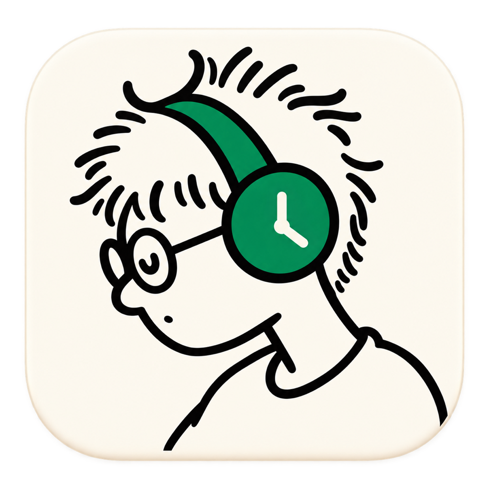
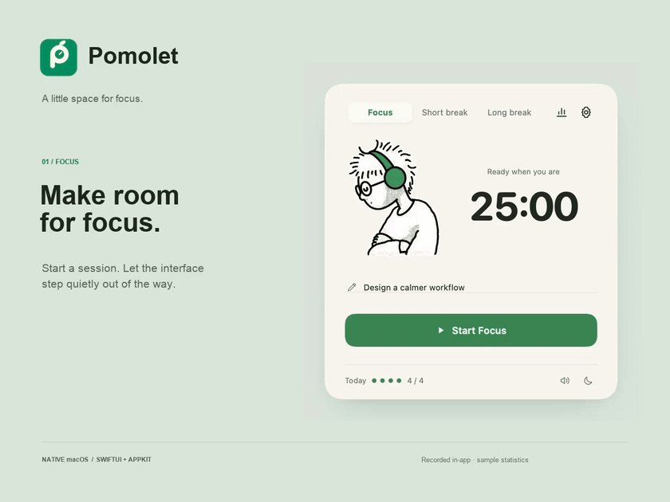

<p align="center"></p>
<h1 align="center">Pomolet</h1>
<p align="center">A small, considered Pomodoro timer for macOS.</p>
<p align="center">SwiftUI · AppKit · AVFoundation · macOS 14+</p>

[简体中文](README.zh-CN.md)

Pomolet pairs a quiet timer with an animated companion. Start a session and the interface makes room for focus: the toolbar and task field leave, the character grows, and a reset control separates from the pause button like a droplet.

## Always on top & edge timer

Use the footer pin or **Window → Always on Top** (⌘⌥P); the preference is saved. Drag the window near any screen's work-area edge and release to dock a compact 320 × 76pt timer with a transparent animated companion protruding above the bar, countdown, play/pause, expand and pin controls. The compact timer follows the same pin preference. Drag its character or numbers away from the edge, click Expand, or press Escape to restore the full window and your previous pin preference, without interrupting the timer. Disable automatic docking under **Window → Snap to Screen Edges**. Docking respects the menu bar, Dock and connected displays; the app starts in full mode on relaunch.

## Demo

[](https://github.com/Davied-H/Pomolet/releases/download/v1.2.0/pomolet-demo-en.mp4)

[Full English demo · 52 seconds · Download MP4](https://github.com/Davied-H/Pomolet/releases/download/v1.2.0/pomolet-demo-en.mp4)

Recorded from the native macOS app in English at 60fps. Includes focus, breaks, statistics, settings and dark appearance. Statistics use isolated sample data.

## Features

- Up to five custom modes, with focus, short-break and long-break character animations.
- Six bundled transparent 60fps videos, randomized actions and seamless poster handoffs.
- Carefully staged transitions, a sliding mode selector and a circular settings reveal.
- Settings save as you edit; task notes, session recovery and local history.
- Four animated statistics cards with daily and weekly charts.
- Warm light appearance and a monochrome dark appearance.
- Keyboard controls and support for Reduce Motion.
- Fully native UI. No WebView, server, account or network connection required.

## Install

Download `Pomolet-macOS.zip` from [Releases](https://github.com/Davied-H/Pomolet/releases), unzip and open `Pomolet.app`.

Requires macOS 14 or newer. The app includes Apple Silicon and Intel binaries. Current releases are locally ad-hoc signed, without Developer ID notarization.

## Build

Install Xcode Command Line Tools, then:

```sh
git clone https://github.com/Davied-H/Pomolet.git
cd Pomolet
./build.sh
open dist/Pomolet.app
```

All runtime assets are included. Building uses the macOS SDK and Swift compiler with no third-party Swift dependencies. Video assets total approximately 200MB.

Open `Package.swift` in Xcode to develop, or use `swift build`. The app bundle with its icon and metadata is produced by `build.sh`.

## Validate

```sh
./test.sh
```

Tests cover 45 business assertions, 50 animation/appearance checks, and native decoding, dimensions and transparency of all six video clips. Reports are written to `docs/`.

See [validation notes](docs/VALIDATION.md) for what was verified and the remaining visual-comparison limits. Intel is compiled but has not been tested on physical Intel hardware.

## Languages

Choose **System**, **中文** or **English** at the top of Settings (Command–comma). Changes apply immediately to the interface and macOS menus, and are saved automatically. Switching languages does not reset the timer. Built-in mode labels are translated; your own mode names, tasks and history remain as written. The default is System: Chinese is used when the primary system language is Chinese; English is used for every other language. System continues to follow locale changes, while an explicit choice is remembered. Older data without a saved choice also uses System.

The source-language catalog lives in `Sources/Localization.swift`. `test.sh` also runs 318 localization checks for translation coverage, formatting, migration and session preservation. Mode names accept up to 24 characters in either language.

## Keyboard

- Space: start/pause when focus is outside text fields and buttons.
- Command–Return: start/pause. Command–R: reset.
- Command–1 / Command–2: timer / statistics. Command–comma: settings.
- Command–D: switch appearance. Escape: dismiss menu or return.
- Arrow keys / Home / End: navigate focused mode tabs and animation menus.

## Project structure

- `Sources/`: native UI, timer state, motion, charts and playback.
- `Resources/`: HEVC Alpha clips, posters, vector UI icons and app icon.
- `Brand/`: editable SVG mark and its PNG rendition.
- `Tests/`: business and visual/motion checks.
- `Tools/`: icon generation, optional asset conversion and isolated QA fixtures.

Regenerate the icon with `swift Tools/GenerateIcon.swift`. Original web assets are only needed if regenerating the video/icon resource conversions; see `Tools/prepare-assets.py` for its explicit source-folder argument. Normal builds do not need the original HTML project.

## Data

Preferences and history stay on your Mac in `~/Library/Application Support/FocusNative/state.json`. The original bundle identifier and storage directory are retained so existing users keep their settings after the rename. Browser demo storage is separate and is not imported automatically.

## License

[MIT](LICENSE). Contributions are welcome.
